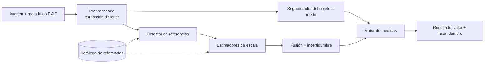

# 📏 Roadmap — Medidor universal con objetos de referencia

> Aplicación **Android** (Flutter) que mide objetos a partir de una fotografía usando como referencia objetos cotidianos de **tamaño normalizado** (tarjetas, monedas, billetes, folios, etc.), con estimación de incertidumbre y fusión de varias referencias. El núcleo de visión se desarrolla y valida en **Python** y se ejecuta **en local, en el móvil**.
> Pensado como proyecto de **portfolio**: modular, evaluado con rigor y ampliable.

---

## Índice

1. [Visión y principios de diseño](#1-visión-y-principios-de-diseño)
2. [Stack tecnológico](#2-stack-tecnológico)
3. [Arquitectura](#3-arquitectura)
4. [Estructura del repositorio](#4-estructura-del-repositorio)
5. [Resumen de fases y calendario](#5-resumen-de-fases-y-calendario)
6. [Fases detalladas (0–20)](#6-fases-detalladas)
7. [Catálogo inicial de referencias](#7-catálogo-inicial-de-referencias)
8. [Protocolo de evaluación](#8-protocolo-de-evaluación)
9. [Riesgos y mitigaciones](#9-riesgos-y-mitigaciones)
10. [Ideas de futuro](#10-ideas-de-futuro)
11. [Recursos de estudio](#11-recursos-de-estudio)

---

## 1. Visión y principios de diseño

**Objetivo:** poder medir cosas prácticamente en cualquier lugar usando solo el móvil y algún objeto cotidiano de medida conocida.

**Principios:**

- **Solo referencias con medida normalizada.** Cada objeto del catálogo debe tener una dimensión oficial o estándar documentada (con su fuente y su tolerancia). Nada de "más o menos".
- **Modularidad.** El núcleo de medición es independiente de la interfaz. Añadir un objeto nuevo al catálogo debe ser añadir datos, no escribir código.
- **Incertidumbre siempre.** Ninguna medida se devuelve como un número suelto: se devuelve `valor ± incertidumbre`.
- **Evaluación antes que funciones.** Una función nueva no está terminada hasta que se mide su error con datos reales.
- **Incremental.** Cada fase termina con algo que funciona y se puede enseñar.
- **Local primero.** El destino final es que todo se ejecute en el móvil, sin conexión y sin enviar fotos a ningún servidor. Cualquier servidor es solo andamiaje de desarrollo.
- **Plataforma objetivo: Android** (desarrollo en PC). iOS queda fuera del alcance de la v1 porque requiere un Mac con Xcode.
- **Python como laboratorio.** Los algoritmos se validan primero en Python; la versión del móvil debe dar los mismos resultados (tests de paridad).

**Qué se mide (alcance por niveles):**

| Nivel | Capacidad |
|-------|-----------|
| N1 | Largo y ancho de objetos planos sobre una superficie plana |
| N2 | Perímetro, área, ángulos, distancias entre puntos |
| N3 | Objetos 3D sencillos (cilindros, esferas, cajas) y alturas |
| N4 | Objetos definidos por el usuario y vista en vivo / realidad aumentada |
| N5 | Personas (opcional) |

---

## 2. Stack tecnológico

| Capa | Tecnología | Motivo |
|------|-----------|--------|
| Lenguaje | **Python 3.11+** | Ecosistema de visión y ML |
| Gestión de proyecto | `uv` (o Poetry), `pyproject.toml` | Entornos reproducibles |
| Visión clásica | **OpenCV**, NumPy, SciPy | Detección de formas, homografía, calibración |
| Modelos de datos | **Pydantic** + YAML | Catálogo validado y extensible |
| Detección con ML | **PyTorch** + **Ultralytics YOLO** | Detección/clasificación de referencias |
| Segmentación | `scikit-image`, GrabCut, **Segment Anything (SAM)** | Aislar el objeto a medir |
| Profundidad (opcional) | Modelos de profundidad monocular (Depth Anything V2, etc.) | Plan B sin referencia |
| App móvil | **Flutter** (Dart), objetivo Android | Interfaz, cámara y sensores; todo en local |
| Núcleo en el dispositivo | **C++** con OpenCV nativo vía `dart:ffi`, o un paquete de OpenCV para Dart (se decide en la Fase 11) | Rendimiento y ejecución sin conexión |
| Base de datos | **SQLite** (`drift` o `sqflite`) | Historial de medidas y objetos definidos por el usuario |
| Inferencia de modelos | **ONNX Runtime** o **TFLite** | Ejecutar el detector en el móvil |
| Servidor de desarrollo (temporal) | **FastAPI** en el PC | Andamiaje para probar la app con medidas reales antes de tener el núcleo en el móvil |
| Demo rápida en PC | **Streamlit** o Gradio (opcional) | Validar el flujo antes de pasar al móvil |
| Tests | `pytest`, `hypothesis` | Tests unitarios y de propiedades |
| Calidad | `ruff`, `mypy`, `pre-commit` | Estilo y tipado |
| CI/CD | GitHub Actions | Tests automáticos |
| Contenedores | Docker (opcional) | Entorno reproducible de entrenamiento y evaluación |
| Experimentos | Jupyter, `matplotlib`, `pandas` | Análisis de error |
| Datos y modelos | Git LFS o DVC | Versionado de datasets |

> **Nota sobre el móvil:** Python no se ejecuta cómodamente en Android con OpenCV y ML, así que su papel es **prototipo, entrenamiento, evaluación e implementación de referencia**. En el móvil, el núcleo se ejecuta con C++/OpenCV nativo (o con un paquete de OpenCV para Dart, si cubre lo necesario) conectado a Flutter. **El C++ no se escribe hasta tener los algoritmos validados en Python** (tras la Fase 8) y la decisión final se toma con datos en la Fase 11. Flutter también da acceso a los sensores de Android (giroscopio, y más adelante ARCore).

---

## 3. Arquitectura



**Conceptos clave:**

- **Referencia:** objeto del catálogo con forma, dimensiones, tolerancia y fuente.
- **Estimador de escala:** módulo que, a partir de una referencia detectada, devuelve la escala `mm/píxel` (o una homografía) y su incertidumbre.
- **Fusión:** combina varios estimadores en uno solo, con mejor precisión y robustez frente a valores atípicos.
- **Motor de medidas:** convierte puntos o contornos de la imagen en medidas reales usando la escala/homografía.
- **Contrato del núcleo:** la entrada (imagen, metadatos, referencias del catálogo) y la salida (detecciones, escala, medidas, incertidumbre) se definen como estructuras de datos idénticas en Python y en el móvil. Esto permite los **tests de paridad** entre ambas implementaciones.
- **Capa móvil:** Flutter (interfaz, cámara, sensores) → núcleo nativo vía FFI → SQLite (historial y objetos del usuario).

---

## 4. Estructura del repositorio

```
medidor/
├── pyproject.toml
├── README.md
├── ROADMAP.md
├── LICENSE
├── catalog/                    # Catálogo de referencias (datos, no código)
│   ├── cards.yaml
│   ├── coins_eur.yaml
│   ├── coins_usd.yaml
│   ├── coins_gbp.yaml
│   ├── banknotes_eur.yaml
│   ├── paper.yaml
│   └── misc.yaml
├── src/medidor/
│   ├── catalog/                # Carga y validación del catálogo
│   ├── calibration/            # Calibración de cámara y distorsión
│   ├── detection/              # Detectores (clásicos y ML)
│   ├── geometry/               # Homografía, PnP, rectificación
│   ├── scale/                  # Estimadores de escala
│   ├── fusion/                 # Fusión e incertidumbre
│   ├── segmentation/           # Segmentación del objeto a medir
│   ├── measure/                # Motor de medidas (largo, área, ángulo...)
│   ├── devserver/              # Servidor de desarrollo temporal (FastAPI)
│   └── cli.py                  # Interfaz de línea de comandos
├── native/                     # Núcleo C++ (si se decide en la Fase 11)
├── app/                        # App Flutter (Android) + SQLite
├── data/
│   ├── raw/                    # Fotos originales
│   ├── annotated/              # Anotaciones
│   └── eval/                   # Set de evaluación con ground truth
├── notebooks/                  # Experimentos y análisis de error
├── tests/
├── docs/
└── scripts/
```

---

## 5. Resumen de fases y calendario

> Estimaciones pensadas para ~6–8 horas semanales compatibles con las asignaturas. Ajusta según tu carga.

| Fase | Nombre | Duración est. | Hito |
|------|--------|---------------|------|
| 0 | Definición y alcance | 1 sem | Repo y plan listos |
| 1 | Fundamentos y entorno | 2 sem | Entorno + teoría base |
| 2 | Catálogo de referencias | 1–2 sem | Catálogo v0 validado |
| 3 | Detección clásica | 2–3 sem | Detecta tarjeta, A4, monedas |
| 4 | Geometría y calibración | 2–3 sem | Homografía + calibración |
| 5 | **MVP por CLI** | 2 sem | 🎯 Primera medida real |
| 6 | Dataset y evaluación | 2–3 sem | Métricas de error v1 |
| 7 | Reconocimiento con ML | 3–4 sem | Detector YOLO entrenado |
| 8 | Incertidumbre y fusión | 2–3 sem | 🎯 Fusión multi-referencia |
| 9 | Medidas avanzadas en plano | 2–3 sem | Área, perímetro, ángulos |
| 10 | Objetos 3D (lata, esferas) | 3–4 sem | PnP y alturas |
| 11 | Decisión de arquitectura móvil (prueba de concepto) | 2–3 sem | Decisión documentada |
| 12 | App Flutter + SQLite | 3–4 sem | App con flujo completo |
| 13 | Núcleo en el dispositivo (offline) | 4–6 sem | 🎯 Demo offline en el móvil |
| 14 | Captura guiada y UX con sensores | 2–3 sem | Menos errores de usuario |
| 15 | Profundidad y sensores (plan B) | 3–4 sem | Medir sin referencia |
| 16 | Objetos definidos por el usuario | 3–5 sem | Reconoce objetos propios |
| 17 | Vista en vivo y realidad aumentada | 4–6 sem | ⚠️ Alcance por confirmar (ver la fase) |
| 18 | Personas (opcional) | 2–3 sem | Altura con referencia en la escena |
| 19 | Calidad, CI y documentación | 2 sem | Proyecto pulido |
| 20 | Portfolio y publicación | 1–2 sem | 🎯 Demo + informe técnico |

**Total aproximado:** 48–68 semanas. Se divide así:

- **Núcleo (Fases 0–13):** unas 31–43 semanas. Termina con la app midiendo sin conexión; ya es un proyecto completo.
- **Mejoras y extensiones (Fases 14–18):** unas 14–21 semanas. Se pueden recortar o reordenar sin dejar el proyecto incompleto.
- **Cierre (Fases 19–20):** calidad, documentación y portfolio.

Los hitos 🎯 son puntos en los que ya tienes algo presentable aunque no sigas. La Fase 13 es la más arriesgada (compilación nativa, FFI, paridad), por eso la Fase 11 existe para reducir esa incertidumbre antes de comprometerse.

---

## 6. Fases detalladas

---

### Fase 0 — Definición y alcance

**Objetivo:** dejar claro qué se va a construir y cómo se sabrá que funciona.

**Tareas:**
- [ ] Crear el repositorio (GitHub), licencia y `README` inicial.
- [ ] Escribir la visión del proyecto y el alcance de la v1 (niveles N1, N2 y N3; N4 y N5 son extensiones planificadas).
- [ ] Definir **métricas de éxito**, por ejemplo: error medio absoluto menor de 1 mm en objetos de hasta 10 cm bajo condiciones controladas.
- [ ] Decidir convenciones: unidades (mm), sistema de coordenadas, formato de salida.
- [ ] Crear tablero de tareas (GitHub Projects o similar) con las fases de este roadmap.
- [ ] Definir la **política del catálogo**: cada entrada exige fuente y tolerancia.

**Entregable:** repo inicializado con documento de visión.

**Criterio de hecho:** puedes explicar en un minuto qué hace el proyecto y cómo se evalúa.

---

### Fase 1 — Fundamentos teóricos y entorno

**Objetivo:** tener el entorno listo y la base teórica necesaria.

**Tareas técnicas:**
- [ ] Configurar entorno con `uv`/Poetry, `ruff`, `mypy`, `pytest`, `pre-commit`.
- [ ] Primer workflow de GitHub Actions que ejecute tests y linters.
- [ ] Verificar instalación de OpenCV y lectura de imágenes con orientación EXIF correcta.

**Teoría a estudiar (con notebook de prácticas):**
- [ ] **Modelo pinhole** de cámara: matriz intrínseca `K`, distorsión radial y tangencial.
- [ ] **Coordenadas homogéneas** y transformaciones proyectivas.
- [ ] **Homografía** entre un plano y la imagen.
- [ ] **Propagación de errores**: cómo se transmite el error de píxel a error en milímetros.
- [ ] Efecto de la perspectiva y del ángulo de la cámara en el error.

**Entregable:** notebook que mide un objeto simulando una cámara sintética con escala conocida.

**Criterio de hecho:** sabes calcular a mano cuántos mm representa un píxel dada la distancia y la focal.

---

### Fase 2 — Catálogo de referencias

**Objetivo:** diseñar el catálogo como datos validados y extensibles.

**Diseño del esquema (ejemplo YAML):**

```yaml
- id: card_id1
  name: Tarjeta ISO/IEC 7810 ID-1
  category: card
  shape: rectangle
  dimensions_mm: { width: 85.60, height: 53.98 }
  tolerance_mm: 0.1
  source: "ISO/IEC 7810"
  aspect_ratio: 1.586
  notes: "Tarjetas bancarias, carnet de conducir, DNI 3.0/4.0"

- id: coin_eur_2
  name: Moneda de 2 euros
  category: coin
  shape: circle
  dimensions_mm: { diameter: 25.75 }
  tolerance_mm: 0.1
  source: "Banco Central Europeo"
```

**Tareas:**
- [ ] Definir modelos Pydantic (`Reference`, `Shape`, `Dimensions`, `Source`).
- [ ] Cargador y validador del catálogo (error claro si falta fuente o tolerancia).
- [ ] Carga del catálogo inicial (ver [sección 7](#7-catálogo-inicial-de-referencias)).
- [ ] **Verificar cada medida contra la fuente oficial** y, si es posible, con un calibre propio. Registrar la verificación.
- [ ] Tests: unicidad de `id`, valores positivos, formas coherentes con sus dimensiones.

**Entregable:** catálogo v0 con tests.

**Criterio de hecho:** añadir un objeto nuevo es editar un YAML y pasan los tests.

---

### Fase 3 — Detección clásica de referencias

**Objetivo:** detectar con OpenCV las referencias más sencillas sin ML.

**Tareas:**
- [ ] Preprocesado: escala de grises, desenfoque, normalización de iluminación (CLAHE).
- [ ] **Rectángulos** (tarjetas, billetes, folios): bordes (Canny), contornos, `approxPolyDP`, filtrado por relación de aspecto.
- [ ] **Círculos** (monedas, CD): transformada de Hough y/o ajuste de **elipses** (`fitEllipse`) para tolerar perspectiva.
- [ ] Refinado de **esquinas con precisión subpíxel** (`cornerSubPix`).
- [ ] Puntuación de confianza por detección.
- [ ] Visualización de depuración (superponer detecciones en la imagen).

**Retos a documentar:** reflejos, fondos con textura, sombras, objetos que se tocan.

**Entregable:** módulo `detection/classical.py` + notebook con ejemplos y fallos.

**Criterio de hecho:** detecta correctamente tarjeta/A4/monedas en un conjunto de 30 fotos en condiciones favorables.

---

### Fase 4 — Geometría y calibración

**Objetivo:** convertir píxeles a milímetros de forma correcta.

**Tareas:**
- [ ] **Calibración de cámara** con tablero de ajedrez (`calibrateCamera`) y guardado de parámetros.
- [ ] Corrección de distorsión (`undistort`) y análisis de cuánto mejora el error.
- [ ] Uso de la **distancia focal del EXIF** como estimación cuando no hay calibración.
- [ ] Cálculo de **homografía** referencia→imagen y rectificación a vista cenital.
- [ ] Escala en el plano rectificado (mm/px) y su incertidumbre.
- [ ] Caso de referencia circular: manejo de la elipse proyectada.
- [ ] Tests con imágenes sintéticas generadas con cámara virtual (la verdad es conocida).

**Entregable:** módulo `geometry/` y `calibration/` con tests sintéticos.

**Criterio de hecho:** en imágenes sintéticas el error es despreciable, y en fotos reales controladas es consistente con el error esperado.

---

### Fase 5 — MVP por línea de comandos 🎯

**Objetivo:** el primer flujo extremo a extremo.

**Flujo:** `foto → detectar referencia → homografía → medir largo y ancho de un objeto → resultado`.

**Tareas:**
- [ ] Segmentación sencilla del objeto a medir (umbral adaptativo / GrabCut).
- [ ] Rectángulo mínimo orientado (`minAreaRect`) para largo y ancho.
- [ ] CLI: `medidor medir foto.jpg --ref card_id1`.
- [ ] Salida en texto y en imagen anotada.
- [ ] Incertidumbre básica a partir del error de esquinas y de la tolerancia de la referencia.

**Entregable:** primera medida real con foto propia, comparada con un calibre.

**Criterio de hecho:** reproduces una medida de un objeto conocido con error razonable y la app te dice cuánto confiar en ella.

---

### Fase 6 — Dataset y evaluación

**Objetivo:** medir el error de forma sistemática, no a ojo.

**Tareas:**
- [ ] Definir el protocolo de captura (ver [sección 8](#8-protocolo-de-evaluación)).
- [ ] Construir un set de **objetos de prueba con medida verificada** (calibre digital).
- [ ] Capturar fotos variando: distancia, ángulo, iluminación, fondo, resolución.
- [ ] Estructura de metadatos por foto (objeto, referencia, condiciones, medida real).
- [ ] Script de evaluación que genere tablas y gráficas: error absoluto, relativo, por condición.
- [ ] Dividir el set en **desarrollo** y **test final** (no tocar este último hasta el final).

**Entregable:** `data/eval/` con ground truth y notebook de resultados.

**Criterio de hecho:** tienes una gráfica "error vs ángulo" y "error vs distancia" para tu MVP.

---

### Fase 7 — Reconocimiento automático con ML

**Objetivo:** que la app identifique sola qué referencia hay en la foto.

**Tareas:**
- [ ] Definir las clases a reconocer (tipo de objeto y, para monedas, denominación y divisa).
- [ ] Construir un dataset propio: fotos variadas + anotación (herramienta tipo CVAT o Label Studio).
- [ ] Aumento de datos (rotación, brillo, desenfoque, perspectiva).
- [ ] Entrenar **YOLO** y comparar con un clasificador sobre recortes.
- [ ] Combinar la detección ML con el refinado geométrico clásico (ML localiza, geometría mide).
- [ ] Métricas: mAP, matriz de confusión, errores típicos (monedas de tamaño parecido).
- [ ] Resolver ambigüedades usando también el **tamaño relativo** entre varias monedas de la escena.

**Retos:** monedas de distintas divisas con tamaños casi idénticos, desgaste, reflejos.

**Entregable:** modelo entrenado y reproducible (script y configuración versionados).

**Criterio de hecho:** el sistema identifica la referencia correcta en el set de test con la precisión que fijaste en la Fase 0.

---

### Fase 8 — Incertidumbre y fusión multi-referencia 🎯

**Objetivo:** la parte que diferencia el proyecto.

**Tareas:**
- [ ] Modelar la incertidumbre de cada estimador (error de detección, tolerancia de la referencia, ángulo, resolución).
- [ ] **Propagación de errores** hasta la medida final (analítica y por Monte Carlo).
- [ ] Fusión de varias referencias: media ponderada por inversa de varianza / mínimos cuadrados.
- [ ] **RANSAC** o criterios robustos para descartar referencias atípicas.
- [ ] Comprobación de **consistencia** entre referencias (si dos referencias discrepan, avisar).
- [ ] Informe de resultado: `valor ± incertidumbre` e intervalo de confianza.
- [ ] Evaluar si la incertidumbre estimada es **realista** (calibración estadística: ¿el 95 % de las medidas cae en el intervalo del 95 %?).

**Entregable:** módulo `fusion/` y notebook "mejora al fusionar referencias".

**Criterio de hecho:** demuestras con datos que fusionar 2–3 referencias reduce el error frente a una sola.

---

### Fase 9 — Medidas avanzadas en el plano

**Objetivo:** ampliar qué se puede medir.

**Tareas:**
- [ ] Medición entre **dos puntos** marcados por el usuario.
- [ ] **Perímetro y área** de formas irregulares a partir de la máscara de segmentación.
- [ ] **Ángulos** entre segmentos.
- [ ] Polilíneas (longitud de un camino o curva).
- [ ] Segmentación mejorada con **SAM** (el usuario toca el objeto y se segmenta).
- [ ] Modo **comparación**: ¿cabe el objeto A en el hueco B?
- [ ] Unidades configurables (mm, cm, pulgadas).

**Entregable:** `measure/` ampliado con tests (formas geométricas de área conocida).

**Criterio de hecho:** medir el área de formas de referencia (círculo, cuadrado impreso) con error documentado.

---

### Fase 10 — Objetos 3D: cilindros, esferas y alturas

**Objetivo:** usar y medir objetos con volumen, como una lata.

**Contexto:** en una lata, la **tapa superior es un círculo plano** (2D) y se puede tratar como una referencia plana, pero el cuerpo es un cilindro 3D. Esta fase aprovecha ambas cosas.

**Tareas:**
- [ ] Modelos 3D sencillos en el catálogo: cilindro (diámetro, altura), esfera (diámetro), caja (largo, ancho, alto).
- [ ] **Estimación de pose con PnP** (`solvePnP`) a partir de puntos conocidos del modelo.
- [ ] Uso del **círculo de la tapa** como referencia plana y gestión de la **ambigüedad de pose** de un círculo (dos soluciones posibles).
- [ ] **Esferas:** el diámetro aparente y la distancia dan escala; estudiar el efecto de la perspectiva (la esfera se proyecta como elipse).
- [ ] **Medir alturas** de objetos usando una referencia de altura conocida en la misma escena.
- [ ] Estimación de la **altura de la cámara** a partir de la pose y su uso para medir objetos sobre el suelo.
- [ ] Volumen aproximado de objetos con forma sencilla (cilindro, caja).
- [ ] Evaluación específica: error en 3D frente al de 2D.

**Entregable:** módulo de referencias 3D y notebook comparativo.

**Criterio de hecho:** mides la altura de un objeto conocido con una lata como referencia y documentas el error.

---

### Fase 11 — Decisión de arquitectura móvil (prueba de concepto)

**Objetivo:** elegir con datos cómo se ejecutará el núcleo en Android antes de invertir semanas en una vía que quizá no funcione.

**Tareas:**
- [ ] Preparar el entorno: Flutter SDK, Android Studio, NDK/CMake y tu móvil Android con depuración por USB.
- [ ] **Prueba A, paquete de OpenCV para Dart:** comprobar si cubre lo que necesitas (detección de contornos, `findHomography`, `cornerSubPix`, `solvePnP`...), qué versión de OpenCV incluye, si está mantenido y cuánto pesa el APK.
- [ ] **Prueba B, núcleo C++ propio:** OpenCV para Android + CMake + `dart:ffi`. Mismo ejemplo (detectar una tarjeta y calcular la homografía). Medir esfuerzo y rendimiento.
- [ ] **Prueba C, plan B:** comprobar si Python con OpenCV/NumPy es viable en Android (por ejemplo con Chaquopy). No es la vía preferida.
- [ ] **Prueba de inferencia:** cargar un modelo pequeño con ONNX Runtime o TFLite desde Flutter y medir la latencia.
- [ ] Tabla comparativa (esfuerzo, rendimiento, mantenimiento, cobertura de funciones) y **decisión documentada (ADR)**.
- [ ] Definir el **contrato del núcleo**: estructuras de entrada y salida, idénticas en Python y en el móvil.

**Entregable:** ADR con la decisión y una app mínima que detecta una referencia en tu móvil.

**Criterio de hecho:** la decisión se apoya en pruebas reales en tu dispositivo, no en suposiciones.

---

### Fase 12 — App Flutter + SQLite

**Objetivo:** construir la app completa, usando un servidor de desarrollo mientras el núcleo no esté en el móvil.

**Tareas:**
- [ ] Arquitectura de la app por capas (presentación, dominio, datos) y gestión de estado (por ejemplo Riverpod).
- [ ] Captura desde **cámara** y **galería**, respetando la orientación EXIF.
- [ ] Pantalla de resultado: imagen anotada, referencia detectada y medidas con incertidumbre.
- [ ] **Selector manual de referencia** con buscador del catálogo, para cuando la detección falle.
- [ ] Marcado táctil de puntos y zoom para medidas entre dos puntos.
- [ ] Catálogo cargado desde `assets` (script que convierte el YAML a JSON en la compilación).
- [ ] **SQLite**: tablas `measurements` (foto, referencia, medidas, incertidumbre, fecha, versión del algoritmo), `user_references` (objetos definidos por el usuario, con etiqueta de menor confianza) y `settings`; migraciones incluidas.
- [ ] **Servidor de desarrollo temporal** en tu PC (Python/FastAPI, accesible por wifi) para obtener medidas reales mientras se construye la interfaz. Es andamiaje, no arquitectura final.
- [ ] Tests de widgets y de la capa de datos.

**Entregable:** app con el flujo completo funcionando contra el servidor de desarrollo.

**Criterio de hecho:** haces una foto en el móvil, ves la medida y queda guardada en el historial.

---

### Fase 13 — Núcleo en el dispositivo (modo offline) 🎯

**Objetivo:** que toda la medición se ejecute en el móvil, sin conexión.

**Tareas:**
- [ ] Implementar según la decisión de la Fase 11: integrar el paquete de OpenCV para Dart **o** construir el núcleo C++ con CMake/NDK y exponerlo por `dart:ffi` con una API C estable (imagen de entrada, estructura de resultado).
- [ ] Si hay C++: portar por orden de sencillez (detección clásica, homografía, escala, fusión, medidas), manteniendo funciones puras y sin estado.
- [ ] Exportar el detector a **ONNX o TFLite** y verificar que da resultados equivalentes a PyTorch.
- [ ] **Cuantización** y optimización; medir latencia, memoria y consumo en tu móvil.
- [ ] Ejecutar la inferencia fuera del hilo de la interfaz (isolates) para que la app no se bloquee.
- [ ] **Tests de paridad:** las mismas fotos del set de evaluación en Python y en el móvil, con diferencia de medida dentro de una tolerancia que fijes de antemano.
- [ ] Retirar el servidor de desarrollo del flujo normal (queda solo como herramienta de desarrollo).
- [ ] Prueba en **modo avión**.

**Entregable:** app que mide sin conexión.

**Criterio de hecho:** una medida completa en pocos segundos, sin red, con resultados equivalentes a la versión de Python.

---

### Fase 14 — Captura guiada y UX con sensores

**Objetivo:** reducir los errores que vienen del usuario, que suelen ser la mayor fuente de error.

**Tareas:**
- [ ] Indicador de **inclinación** con acelerómetro y giroscopio (avisar si el móvil no está paralelo a la superficie).
- [ ] Usar la inclinación medida como **entrada del modelo de incertidumbre** y guardarla en SQLite junto con la medida.
- [ ] Avisos de calidad en directo: desenfoque, poca luz, referencia cortada o parcialmente tapada.
- [ ] Guía visual de encuadre y mensajes de error accionables ("acerca el móvil", "evita el reflejo").
- [ ] Procedimiento de **calibración de la cámara del móvil** dentro de la app (con un tablero impreso) y almacenamiento de los parámetros.
- [ ] Modo "varias fotos" para promediar medidas.
- [ ] Prueba de usabilidad con 3–5 personas y recogida de feedback.

**Entregable:** flujo de captura guiado y calibración integrada.

**Criterio de hecho:** el error medio de usuarios no expertos baja respecto al flujo sin guía (medido).

---

### Fase 15 — Profundidad y sensores (plan B)

**Objetivo:** medir cuando no hay ninguna referencia a mano (con menos precisión).

**Tareas:**
- [ ] Modelo de **profundidad métrica monocular** exportado a ONNX/TFLite, si el rendimiento en el móvil lo permite.
- [ ] **ARCore Depth API** (Android): comprobar si tu dispositivo es compatible, integrarlo mediante un plugin o código nativo y tratarlo como un estimador más. Esta integración se reutiliza en la Fase 17.
- [ ] Incorporar ambos a la fusión con una incertidumbre mucho mayor que la de las referencias de catálogo.
- [ ] Usarlos también para **comprobar la consistencia** de la escala cuando hay referencia.
- [ ] Evaluar su error con honestidad y mostrar en la interfaz que la medida es de baja confianza.

**Entregable:** estimadores adicionales integrados y comparativa de error.

**Criterio de hecho:** con una referencia, el sistema mejora o iguala el resultado; sin referencia, devuelve una medida con incertidumbre realista.

---

### Fase 16 — Objetos definidos por el usuario

**Objetivo:** que el usuario añada sus propios objetos como referencias, con sus medidas reales, y que la app los reconozca después.

**Tareas:**
- [ ] **Flujo de alta:** fotografiar el objeto desde 3–5 ángulos, introducir sus medidas reales y la unidad, e indicar su forma (plano, cilindro, caja...) y qué dimensión sirve de referencia.
- [ ] **Guía de medición** para el usuario (cómo medir bien con regla o calibre) y registro de cómo midió.
- [ ] **Plantilla visual:** extraer características locales (ORB/SIFT) y/o un embedding visual ligero; guardarlos en SQLite (`user_references`) junto con las dimensiones.
- [ ] **Reconocimiento:** emparejado de características con verificación geométrica (RANSAC + homografía) para confirmar el objeto y obtener su pose; umbrales de confianza para evitar falsos positivos.
- [ ] **Integración en la fusión:** etiqueta de **confianza menor** y una incertidumbre que defina el usuario (por defecto alta). Si discrepa de una referencia oficial, nunca prevalece.
- [ ] Avisar en la interfaz cuando una medida depende de un objeto del usuario.
- [ ] Editar y borrar objetos propios; exportar e importar en JSON.
- [ ] **Evaluación:** tasa de falsos positivos y negativos con 5–10 objetos propios, y cómo se propaga el error de la medida introducida al resultado final.

**Entregable:** módulo de objetos de usuario integrado en la app y en la fusión.

**Criterio de hecho:** das de alta un objeto propio, la app lo reconoce en fotos nuevas y lo usa como referencia con la incertidumbre correcta.

---

### Fase 17 — Vista en vivo y realidad aumentada ⚠️ (alcance por confirmar)

**Estado:** anotada, pero **sin alcance cerrado**. Depende de tres cosas que solo se pueden saber después de la Fase 13: si tu móvil es compatible con ARCore, cuántos fotogramas por segundo aguanta la detección en el dispositivo y cuánto tiempo queda. Por eso la fase se plantea en **escalones** y empieza con un punto de control.

**Punto de control (antes de empezar):**
- [ ] Comprobar la **compatibilidad de tu móvil con ARCore** y qué plugin o código nativo permite usarlo desde Flutter (verificar versiones y mantenimiento).
- [ ] Usar la latencia medida en la Fase 13 para decidir cada cuántos fotogramas se puede detectar.
- [ ] Decidir hasta qué escalón se llega y dejarlo documentado.

**Escalón A: vista en vivo con superposición (el más probable)**
- [ ] Vista previa de la cámara con detección ligera de referencias cada N fotogramas.
- [ ] Superponer el contorno de la referencia y una **medida provisional** sobre la imagen.
- [ ] Estabilizar la medida promediando los últimos fotogramas y mostrar un indicador de estabilidad.
- [ ] Congelar y guardar la medida con un toque.

**Escalón B: ARCore (condicionado al punto de control)**
- [ ] Integrar ARCore (planos, pruebas de impacto y anclas).
- [ ] Medir entre dos puntos anclados en un plano detectado, con escala métrica.
- [ ] Usar ARCore como **estimador adicional** en la fusión y contrastarlo con las referencias de catálogo.
- [ ] Modo "AR sin referencia" con incertidumbre mayor, indicado claramente en la interfaz.
- [ ] Mostrar la medida como superposición anclada en el espacio.

**Escalón C: solo si sobra tiempo**
- [ ] Fusión en tiempo real entre la referencia de catálogo y ARCore.

**Entregable:** el escalón A funcionando y, si el punto de control lo permite, el B.

**Criterio de hecho:** medidas en vivo estables en tu móvil. Si ARCore no es viable, se documenta el motivo y el proyecto se queda en el escalón A, sin que eso lo deje incompleto.

---

### Fase 18 — Personas (opcional)

**Objetivo:** estimar la altura de una persona con una referencia en la escena. Es la extensión menos fiable y se puede omitir.

**Tareas:**
- [ ] Modelo de **pose humana** ligero con exportación a TFLite/ONNX (comprobar qué opciones hay y su licencia).
- [ ] Condiciones de captura: persona de pie, cuerpo entero, cámara estable y a la altura del torso.
- [ ] Combinar los puntos clave (cabeza y pies) con una referencia visible en el mismo plano que la persona.
- [ ] Incertidumbre alta y explícita (postura, calzado, pelo, perspectiva).
- [ ] Evaluación con al menos 10 voluntarios, con su consentimiento, y sin guardar las fotos.

**Entregable:** estimador de altura de personas integrado en la fusión.

**Criterio de hecho:** error documentado con intervalos honestos y avisos claros en la interfaz.

---

### Fase 19 — Calidad, CI y documentación

**Objetivo:** que el proyecto parezca (y sea) profesional.

**Tareas:**
- [ ] Cobertura de tests razonable en el núcleo y tests de regresión sobre el set de evaluación.
- [ ] CI completo: lint, tipos, tests de Python y build de la app Android (APK).
- [ ] Documentación de usuario y de desarrollador (MkDocs o similar).
- [ ] Guía de contribución: **cómo añadir una referencia nueva al catálogo**.
- [ ] Revisión de rendimiento (perfilado de los cuellos de botella).
- [ ] Gestión de versiones y `CHANGELOG`.
- [ ] Revisión de privacidad: las fotos no se almacenan salvo que el usuario lo pida.

**Entregable:** repositorio limpio con documentación.

**Criterio de hecho:** otra persona puede clonar, instalar y ejecutar el proyecto siguiendo el README.

---

### Fase 20 — Portfolio y publicación 🎯

**Objetivo:** convertir el proyecto en algo que se pueda enseñar.

**Tareas:**
- [ ] README con GIFs/capturas, instalación en 3 comandos y tabla de resultados.
- [ ] **Informe técnico** o artículo: metodología, evaluación, limitaciones.
- [ ] Vídeo demo corto (1–2 min) midiendo objetos reales con distintas referencias.
- [ ] APK descargable con enlace público (y, opcionalmente, publicación en Google Play).
- [ ] Sección de "limitaciones conocidas" (esto da credibilidad).
- [ ] Publicar el dataset de evaluación si es posible.
- [ ] Preparar cómo explicarlo en una entrevista: problema, decisiones, errores y mejoras.

**Entregable:** proyecto publicado y presentable.

**Criterio de hecho:** alguien que no te conoce entiende qué hace y puede probarlo en menos de 5 minutos.

---

## 7. Catálogo inicial de referencias

> ⚠️ **Verifica cada valor** contra la fuente oficial o con un calibre antes de darlo por bueno. Los valores de abajo son los habituales, pero la política del catálogo exige registrar fuente y tolerancia.

### Tarjetas y documentos

| Objeto | Dimensiones (mm) | Notas |
|--------|------------------|-------|
| Tarjeta ID-1 (bancarias, carnet de conducir, DNI electrónico) | 85,60 × 53,98 | Estándar ISO/IEC 7810 |
| Tarjeta SIM (formato mini) | 25 × 15 | Estándar de tarjetas SIM |
| Baraja de cartas (formato póker) | 63,5 × 88,9 | Varía según fabricante, verificar |

### Papel

| Objeto | Dimensiones (mm) | Notas |
|--------|------------------|-------|
| Folio A4 | 210 × 297 | ISO 216 |
| Carta (US Letter) | 215,9 × 279,4 | Muy usado en América |

### Monedas (diámetro en mm)

| Euro | | Dólar USA | | Libra esterlina | |
|------|---|-----------|---|-----------------|---|
| 1 c | 16,25 | 1 c (penny) | 19,05 | 1 p | 20,3 |
| 2 c | 18,75 | 5 c (nickel) | 21,21 | 2 p | 25,9 |
| 5 c | 21,25 | 10 c (dime) | 17,91 | 5 p | 18,0 |
| 10 c | 19,75 | 25 c (quarter) | 24,26 | 10 p | 24,5 |
| 20 c | 22,25 | 50 c | 30,61 | 20 p | 21,4 (heptagonal) |
| 50 c | 24,25 | 1 $ | 26,49 | 50 p | 27,3 (heptagonal) |
| 1 € | 23,25 | | | 1 £ | 23,43 (12 lados) |
| 2 € | 25,75 | | | 2 £ | 28,4 |

### Billetes en euros (largo × ancho, mm)

| Billete | Dimensiones |
|---------|-------------|
| 5 € | 120 × 62 |
| 10 € | 127 × 67 |
| 20 € | 133 × 72 |
| 50 € | 140 × 77 |
| 100 € | 147 × 82 |
| 200 € | 153 × 82 |
| 500 € | 160 × 82 |

Billete de dólar USA: aprox. 155,96 × 66,29 mm (verificar).

### Objetos cotidianos normalizados

| Objeto | Dimensiones | Notas |
|--------|-------------|-------|
| CD / DVD | Ø 120 mm (agujero Ø 15 mm) | Muy preciso |
| Pieza de Lego (separación entre tetones) | 8,0 mm | Separación entre tetones del sistema Lego |
| Pila AA | Ø 14,5 × 50,5 mm | Norma de pilas; verificar por marca |
| Matrícula europea | 520 × 110 mm | Útil en exteriores |
| Palé europeo (EUR/EPAL) | 1200 × 800 mm | Útil en almacenes y exteriores |
| Pelota de ping-pong | Ø 40 mm | Reglamento oficial |
| Pelota de tenis | Ø 65,4–68,6 mm | Rango oficial, tolerancia mayor |
| Balón de fútbol (talla 5) | Circunferencia 68–70 cm | Tolerancia mayor |
| Lata de refresco 330 ml | Ø ~66 × ~115 mm | Dimensiones habituales; verificar con calibre; tapa superior Ø menor |
| Cubo de Rubik 3×3 | ~57 mm de arista | Verificar por marca |

> **Regla de oro:** si un objeto no tiene una dimensión fija documentada o varía mucho entre fabricantes, **no entra** al catálogo (o entra con tolerancia grande y baja prioridad en la fusión).

---

## 8. Protocolo de evaluación

**Variables a controlar en las fotos de evaluación:**

| Variable | Niveles sugeridos |
|----------|-------------------|
| Distancia cámara-objeto | 20, 30, 50, 80 cm |
| Ángulo de la cámara respecto a la normal | 0°, 15°, 30°, 45° |
| Iluminación | Luz natural, luz artificial cálida, poca luz |
| Fondo | Liso claro, liso oscuro, con textura |
| Referencia | Tarjeta, moneda, A4, combinaciones |
| Resolución | Completa y reducida |

**Métricas:**
- Error absoluto medio (**MAE**) y error relativo (%).
- Desviación típica del error.
- **Cobertura del intervalo**: porcentaje de medidas reales dentro del intervalo anunciado.
- Tasa de fallos de detección.
- Tiempo de procesado.

**Buenas prácticas:**
- Medir cada objeto de prueba con **calibre digital** varias veces y usar la media como verdad.
- Separar **conjunto de desarrollo** y **conjunto de test final**.
- Guardar todos los resultados en un fichero versionado para comparar entre versiones del algoritmo.
- Informar siempre de los **casos peores**, no solo de la media.

---

## 9. Riesgos y mitigaciones

| Riesgo | Impacto | Mitigación |
|--------|---------|------------|
| Alcance demasiado grande | Proyecto sin terminar | Fases incrementales con hitos 🎯; el núcleo termina en la Fase 13 y todo lo posterior (Fases 14–18) se puede recortar sin dejar el proyecto incompleto |
| Perspectiva y referencia no coplanar | Error grande | Captura guiada, aviso de inclinación, modelo de incertidumbre |
| Medidas del catálogo erróneas | Error sistemático | Fuente obligatoria y verificación con calibre |
| Monedas parecidas confundidas | Escala errónea | Usar tamaño relativo y consistencia entre referencias |
| Falta de datos para entrenar | Detector flojo | Aumento de datos, empezar con detección clásica, pocas clases |
| Modelos pesados para el móvil | Lentitud | Cuantización, modelos pequeños, trabajar a menor resolución |
| Compilar OpenCV/C++ para Android y conectarlo con Flutter | Semanas de bloqueo | Prueba de concepto en la Fase 11 antes de comprometerse; plan B con paquete de Dart |
| Núcleo en dos lenguajes (Python y móvil) | Resultados distintos | Contrato común y tests de paridad sobre el set de evaluación |
| Solo Android (sin iOS) | Alcance reducido | Declarado fuera del alcance de la v1; iOS como idea de futuro |
| Realidad aumentada: dependencia de ARCore y tiempo real en Flutter | Fase sin completar | Alcance por escalones con punto de control; el escalón A (vista en vivo) no depende de ARCore |
| Objetos del usuario con medidas mal introducidas | Medidas erróneas con apariencia de fiabilidad | Guía de medición, incertidumbre definida por el usuario y menor peso en la fusión |
| Estimación de altura de personas poco fiable | Resultados engañosos | Fase opcional, incertidumbre alta y avisos explícitos |
| Reflejos y sombras | Detección fallida | Preprocesado, avisos de calidad, repetir foto |
| Tiempo limitado (estudios) | Retrasos | Planificar por hitos, tener siempre una versión demostrable |
| Privacidad de las fotos | Confianza | No almacenar por defecto, procesar en el dispositivo cuando sea posible |

---

## 10. Ideas de futuro

Funciones que quedan **fuera del alcance de la v1**. Las que antes figuraban aquí (objetos definidos por el usuario, realidad aumentada y detección de personas) ya están dentro del roadmap, en las Fases 16, 17 y 18.

1. **Reconstrucción 3D a partir de varias fotos**
   - Estructura desde movimiento para obtener volúmenes, con la escala dada por la referencia.

2. **Versión para iOS**
   - Portar la app a iPhone (requiere un Mac con Xcode) y usar LiDAR como estimador adicional en los modelos que lo tengan.

3. **Calibración de la cámara sin tablero**
   - Aprender los parámetros de la cámara del móvil a partir de las propias fotos del usuario (la versión con tablero impreso ya está en la Fase 14).

4. **Catálogos compartidos**
   - Importar y exportar paquetes de referencias verificadas entre usuarios.

5. **Exportación de medidas**
   - CSV, PDF o integración con herramientas de diseño/CAD sencillas.

---

## 11. Recursos de estudio

**Libros**
- *Multiple View Geometry in Computer Vision* — Hartley y Zisserman (geometría proyectiva, homografía, calibración).
- *Computer Vision: Algorithms and Applications* — Richard Szeliski (visión por computador general).
- *Learning OpenCV 4* — Kaehler y Bradski (práctica con OpenCV).

**Artículos clave**
- Zhang, Z. — *A Flexible New Technique for Camera Calibration* (calibración con tablero plano).
- Documentación de **Segment Anything (SAM)** y de los modelos de profundidad monocular que decidas usar.

**Documentación**
- Tutoriales oficiales de OpenCV (calibración, homografía, `solvePnP`).
- Documentación de Ultralytics (entrenamiento y exportación de YOLO).
- Documentación de Flutter (cámara, sensores, `dart:ffi`), Android NDK/CMake, ONNX Runtime y TFLite para móvil, y SQLite con `drift`.
- Documentación de ARCore para Android y de OpenCV (`features2d`, emparejado de características).

**Conceptos para repasar antes de cada bloque**

| Bloque | Conceptos |
|--------|-----------|
| Fases 1–4 | Pinhole, homografía, distorsión, subpíxel |
| Fases 6–8 | Estadística de errores, intervalos de confianza, mínimos cuadrados, RANSAC |
| Fase 7 | Detección de objetos, mAP, aumento de datos |
| Fase 10 | `solvePnP`, ambigüedad de pose, geometría 3D |
| Fases 11–15 | Flutter, FFI y NDK, SQLite, cuantización, ONNX/TFLite, sensores del móvil |
| Fases 16–18 | Emparejado de características (ORB/SIFT) y RANSAC, ARCore (planos y anclas), estimación de pose humana |

---

## ✅ Checklist global de hitos

- [ ] 🎯 **Hito 1 (Fase 5):** primera medida real por CLI.
- [ ] 🎯 **Hito 2 (Fase 8):** fusión multi-referencia con incertidumbre validada.
- [ ] 🎯 **Hito 3 (Fase 13):** app funcionando en el móvil sin conexión.
- [ ] **Hito de extensiones (Fases 16–17):** objetos de usuario y vista en vivo funcionando; AR con ARCore según el punto de control.
- [ ] 🎯 **Hito 4 (Fase 20):** proyecto publicado con informe y vídeo.

> **Consejo final:** si el tiempo aprieta, el proyecto ya es sólido al llegar a la Fase 8 con una evaluación rigurosa. Todo lo posterior suma, pero el valor diferencial está en medir bien y saber cuánto error tienes. La frontera práctica está en la Fase 13: con la app midiendo sin conexión ya tienes un proyecto completo, y las Fases 14–18 son mejoras que puedes añadir según el tiempo (la realidad aumentada es la más dependiente del hardware).
